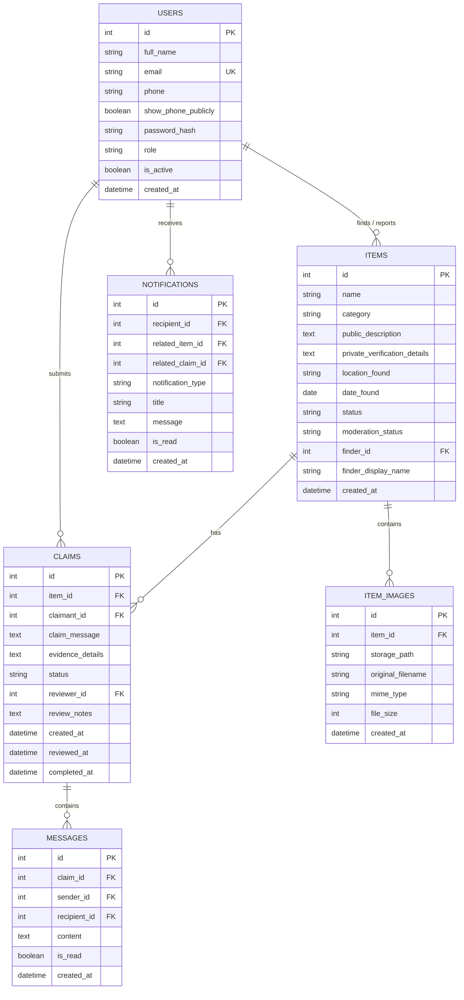

# Group No1 — Global Lost & Found Management System

> **“Lost Something? Found Something? Let’s Bring It Back.”**

Group No1 is a full-stack, database-driven web application built to connect communities worldwide to report found belongings, search for lost items, verify ownership securely, communicate privately, and reunite belongings with their rightful owners.

---

## 📑 Table of Contents

1. [Features & Capabilities](#features--capabilities)
2. [Technology Stack](#technology-stack)
3. [Project Structure](#project-structure)
4. [Step-by-Step Installation & Execution Guide (VS Code / Windows)](#step-by-step-installation--execution-guide-vs-code--windows)
5. [Demonstration Credentials](#demonstration-credentials)
6. [Testing the Application](#testing-the-application)
7. [Database Schema & Architecture](#database-schema--architecture)
8. [Security & Privacy Controls](#security--privacy-controls)
9. [Troubleshooting Guide](#troubleshooting-guide)
10. [Feature Inventory: Implemented vs Optional](#feature-inventory-implemented-vs-optional)

---

## 🌟 Features & Capabilities

- **Sticky Navigation & Branding**: Retains the modern purple-blue gradient identity with dynamic links reflecting authenticated user state, notification counter badge, and responsive mobile drawer.
- **Hero & Call-to-Actions**: Working "Report Found Item" and "Search Lost Items" triggers paired with real-time database query teaser.
- **The 4 Core Platform Pillars**:
  1. 🔍 **Smart Search**: Real-time filtering by item keyword, location, category, status, and chronological sorting.
  2. 🔒 **Secure Verification**: Proprietary private verification details are stored safely and never disclosed in public views or search indices.
  3. 💬 **Safe In-App Communication**: Confidential messaging between finder and claimant without exposing personal phone numbers or home addresses.
  4. 🌍 **Global Platform**: City and neighborhood level indexing allowing localized or international lost property discovery.
- **Item Details & Photo Gallery**: Supports multiple high-resolution photos, thumbnail preview carousel, status badges, finder badges, and interactive modals.
- **End-to-End Claim Lifecycle**:
  - `Pending` &rarr; `Under Review` &rarr; `Approved` &rarr; `Completed`.
  - Finder reviews evidence, records notes, and approves/rejects claims.
  - Final item handoff marks the report as `Returned`.
- **User Dashboard & Real Trust Score**:
  - Real database counts for "My Found Items" and "My Claims".
  - Transparent, computed trust scoring model based on verified returns (+0.25) and completed handoffs (+0.20), displaying "Not yet rated" for zero activity.
  - Recent activity feeds and incoming claim alerts.
- **Multi-File Photo Uploads**: Drag-and-drop / clickable dashed upload zone, dynamic client-side image preview thumbnails, and individual file removal before submission.
- **Profile & Privacy Management**: Edit display name, phone number, toggle phone privacy setting, and securely change password.

---

## 💻 Technology Stack

- **Frontend**: HTML5, Modern CSS3 (CSS Grid & Flexbox, gradient styling `#667eea` to `#764ba2`), Vanilla JavaScript (Fetch API, Modal manager, preview manager, notifications polling).
- **Backend**: Python 3.10+ / 3.13, Flask 3.x.
- **Database & ORM**: SQLite (default local zero-configuration database) with SQLAlchemy ORM (configured so PostgreSQL can be plugged in via `DATABASE_URL`).
- **Authentication**: Flask-Login session management with Scrypt salted password hashing.
- **Security & Forms**: Flask-WTF with CSRF token validation, input sanitization, and secure file upload handling.
- **Abuse Prevention**: Flask-Limiter for rate limiting sensitive endpoints (login, register).
- **Testing**: Pytest with automated coverage for authentication, item search, claims workflow, and data persistence.

---

## 📁 Project Structure

```text
group-no1/
├── app/
│   ├── __init__.py               # Application factory, error handlers, template context
│   ├── models.py                 # SQLAlchemy models: User, Item, ItemImage, Claim, Message, Notification
│   ├── extensions.py             # Extension singletons (db, login_manager, csrf, limiter)
│   ├── auth/
│   │   ├── __init__.py
│   │   ├── routes.py             # Login, register, logout, profile, password change
│   │   └── forms.py              # WTForms with validation
│   ├── items/
│   │   ├── __init__.py
│   │   ├── routes.py             # Search, report, detail, edit, delete, image server
│   │   └── forms.py              # Report and filter forms
│   ├── claims/
│   │   ├── __init__.py
│   │   ├── routes.py             # Claim submission, finder review, handoff, in-app chat
│   │   └── forms.py              # Claim and review forms
│   ├── dashboard/
│   │   ├── __init__.py
│   │   └── routes.py             # Real counts, my items, my claims, recent activity
│   ├── notifications/
│   │   ├── __init__.py
│   │   └── routes.py             # Notification feeds, mark-as-read, unread badge API
│   ├── api/
│   │   ├── __init__.py
│   │   └── routes.py             # JSON endpoints for live modal and dynamic search
│   ├── main/
│   │   ├── __init__.py
│   │   └── routes.py             # Home, About & Team, Terms, Privacy Policy
│   ├── static/
│   │   ├── css/
│   │   │   └── style.css         # Complete responsive styles & gradient theme
│   │   ├── js/
│   │   │   └── app.js           # Modal handlers, file previews, unread polling
│   │   └── images/
│   │       └── placeholder.svg   # Fallback SVG illustration for items
│   └── templates/
│       ├── base.html             # Master layout with navigation and footer
│       ├── index.html            # Hero, feature cards, recent items, team section
│       ├── search.html           # Advanced search, filters, results grid
│       ├── item_detail.html      # Public item view, gallery, owner management
│       ├── report_item.html      # Found item submission with image previews
│       ├── edit_item.html        # Report editing view
│       ├── submit_claim.html     # Claim submission form
│       ├── claim_detail.html     # Claim review, private evidence, and in-app chat
│       ├── dashboard.html        # Real stats cards, incoming claim alerts
│       ├── my_items.html         # User's reported items
│       ├── my_claims.html        # User's claims
│       ├── profile.html          # Contact info, trust score, change password
│       ├── notifications.html    # In-app notifications
│       ├── about.html            # Configurable Team / About section
│       ├── terms.html            # Terms of service and disclaimer
│       ├── privacy.html          # Privacy policy
│       └── errors/
│           ├── 400.html          # Bad Request
│           ├── 403.html          # Access Forbidden
│           ├── 404.html          # Not Found
│           └── 500.html          # Internal Server Error
├── instance/
│   └── lost_and_found.db         # Persistent SQLite database
├── uploads/                      # Secure uploaded item images
├── tests/
│   ├── conftest.py               # In-memory test DB & user/item fixtures
│   ├── test_auth.py              # 7 automated authentication tests
│   ├── test_items.py             # 11 automated item & search tests
│   ├── test_claims.py            # 7 automated claim lifecycle tests
│   └── test_dashboard.py         # 3 automated dashboard & persistence tests
├── config.py                     # Config classes (Development, Testing, Production)
├── run.py                        # Local development entry point
├── seed.py                       # Demonstration data seeder (idempotent)
├── requirements.txt              # Production and test Python dependencies
├── .env.example                  # Environment configuration template
├── .gitignore                    # Git tracking rules
└── README.md                     # Comprehensive documentation
```

---

## 🚀 Step-by-Step Installation & Execution Guide (VS Code / Windows)

Follow these exact steps in your Visual Studio Code terminal on Windows.

### Step 1: Verify Python & Pip Prerequisites

Open the terminal in VS Code (`Terminal -> New Terminal` or `Ctrl + ~`). Confirm Python 3.10+ and pip are installed:

```powershell
python --version
pip --version
```

*(If `python` is not recognized, try `py --version`)*.

---

### Step 2: Open the Project Folder

Ensure your VS Code workspace is open to the `group-no1` folder (or the root workspace containing `group-no1`):

```powershell
cd "c:\Users\Abdul Gafur\Desktop\back to you\group-no1"
```

---

### Step 3: Create & Activate a Virtual Environment

Create an isolated virtual environment:

```powershell
py -m venv .venv
```

Activate the virtual environment in PowerShell:

```powershell
.\.venv\Scripts\Activate.ps1
```

> **Execution Policy Workaround**: If Windows PowerShell displays `script execution is disabled on this system`, enable script execution for your current terminal session safely without changing global system security:
> ```powershell
> Set-ExecutionPolicy -Scope Process -ExecutionPolicy Bypass
> .\.venv\Scripts\Activate.ps1
> ```
> Alternatively, you can always execute Python directly via `.\.venv\Scripts\python.exe`.

---

### Step 4: Install Dependencies

Install all required packages from `requirements.txt`:

```powershell
python -m pip install -r requirements.txt
```

---

### Step 5: Configure Environment Variables

Create your local `.env` configuration file from the provided template:

```powershell
Copy-Item .env.example .env
```

*(A preconfigured development `.env` is already created for immediate local running)*.

---

### Step 6: Initialize the Database

The database tables are automatically verified and initialized upon server startup. If you wish to manually initialize the schema at any time, run:

```powershell
python -c "from app import create_app; from app.extensions import db; app = create_app(); app.app_context().push(); db.create_all(); print('Database tables verified.')"
```

The SQLite database file is stored at: `instance/lost_and_found.db`.

---

### Step 7: Populate Demonstration Data

Run the idempotent database seed script to populate sample items across all categories, demo users, verified claims, in-app messages, and notifications:

```powershell
python seed.py
```

You can run this command at any time without creating duplicate entries.

---

### Step 8: Start the Local Development Server

Start the Flask application server:

```powershell
python run.py
```

You will see output confirming:
```text
============================================================
 Group No1 — Global Lost & Found Management System
 Running at: http://127.0.0.1:5000
 Press CTRL+C to quit the server
============================================================
```

---

### Step 9: Open the Application in Your Browser

Open your web browser and navigate to:

👉 **[http://127.0.0.1:5000](http://127.0.0.1:5000)**

---

## 🔑 Demonstration Credentials

The seed script initializes four clearly identified test accounts:

| User Type | Email | Password | Role / Purpose |
| :--- | :--- | :--- | :--- |
| **Standard Member** | `demo@example.com` | `Password123!` | Active user with reported items & completed return |
| **Finder User** | `jane@example.com` | `Password123!` | Finder of iPhone 13 Pro & Leather Wallet |
| **Claimant User** | `alex@example.com` | `Password123!` | Owner who submitted claim for iPhone 13 Pro |
| **Platform Admin** | `admin@example.com` | `AdminPassword123!` | System administrator with moderation permissions |

---

## 🧪 Testing the Application

Group No1 includes a comprehensive automated test suite with **28 passing unit and integration tests** using Pytest.

### Running the Test Suite:

In your terminal with the virtual environment activated, run:

```powershell
python -m pytest tests -v
```

### Coverage Highlights:
- **Authentication**: Registration, duplicate rejection, hashed password validation, login credential verification, logout invalidation, route protection.
- **Items & Search**: CRUD operations, keyword query, category filtering, location filtering, combined filters, image upload validation.
- **Confidentiality & Authorization**: Verifies private verification details are hidden from public queries; verifies non-owners cannot edit or access third-party claims.
- **Claims Lifecycle**: Submission, duplicate prevention, finder review & approval, return completion, safe in-app messaging.
- **Dashboard & Persistence**: Verifies counts reflect actual database rows and trust scores remain accurate across restarts.

---

## 🗄️ Database Schema & Architecture

The database schema is fully normalized and follows relational integrity principles:



---

## 🛡️ Security & Privacy Controls

1. **Password Hashing**: Stored using modern `scrypt` cryptographic hashing with unique salts. Plaintext passwords are never stored or logged.
2. **Confidential Verification Details**: `private_verification_details` are excluded from all public search results, cards, and REST API queries. Only the finder or admin can view them.
3. **Object-Level Authorization**: Every claim detail and management view verifies whether `current_user` is the claimant, the finder, or an administrator. Tampering with IDs in URLs returns `403 Forbidden`.
4. **Safe In-App Communication**: Finders and claimants communicate within protected claim threads, keeping personal phone numbers and private emails confidential.
5. **File Upload Hardening**:
   - Filenames are sanitized and assigned randomized UUID prefixes.
   - File extensions and MIME types are whitelisted (`png`, `jpg`, `jpeg`, `gif`, `webp`).
   - Request payloads are capped at 16MB; individual files are capped at 5MB.
6. **SQL Injection Prevention**: SQLAlchemy parameterized queries are used exclusively.
7. **Cross-Site Scripting (XSS)**: Automatic context-aware Jinja2 escaping and manual JSON sanitation.
8. **CSRF Protection**: All state-changing POST requests require a valid CSRF token.
9. **Rate Limiting**: Login and registration endpoints are protected via Flask-Limiter to stop brute-force attacks.

---

## 🛠️ Troubleshooting Guide

| Issue | Cause | Solution |
| :--- | :--- | :--- |
| **Python not recognized** | Python is not added to Windows PATH | Use `py` or run `& "C:\Users\<User>\AppData\Local\Programs\Python\Python313\python.exe"` directly. |
| **Virtual environment activation blocked** | PowerShell execution policy restriction | Run `Set-ExecutionPolicy -Scope Process -ExecutionPolicy Bypass` in the current terminal window. |
| **Port 5000 already in use** | Another instance or background process is using port 5000 | Set `$env:FLASK_RUN_PORT=5001` in PowerShell and run `python run.py`. |
| **Database file missing** | SQLite database has not yet been initialized | Run `python seed.py` or start the application via `python run.py`, which creates it automatically. |
| **Upload file rejected** | File is larger than 5MB or invalid image format | Ensure image is in PNG, JPG, JPEG, GIF, or WEBP format and under 5MB. |
| **Styles or icons not updating** | Browser cached previous static CSS/JS | Perform a hard refresh (`Ctrl + F5` or `Ctrl + Shift + R`). |
| **Session expires immediately** | Browser blocking cookies or incorrect cookie domain | Check that `.env` has `SESSION_COOKIE_SECURE=False` for local `http://127.0.0.1` development. |
| **403 Forbidden on Claim** | Attempting to view someone else's private claim | Only the claimant who filed the claim and the item finder have authorization to inspect evidence. |

---

## 📋 Feature Inventory: Implemented vs Optional

### ✅ Fully Implemented Core Requirements:
- Complete branding overhaul: Consistent use of **Group No1**, browser title `Group No1 — Global Lost & Found`, and tagline.
- Rebuilt navigation bar with conditional visitor/authenticated links and notification badge.
- Original hero section with working "Report Found Item" and "Search Lost Items" call-to-actions.
- All 4 original feature cards: Smart Search, Secure Verification, Safe Communication, Global Platform.
- Real database-backed search with keyword, location, category, status, and chronological sorting.
- Found item reporting with multi-image file uploads, real-time thumbnail previews, and client-side removal before submission.
- Item detail modal with dynamic API data fetching and standalone responsive full page.
- Complete claim workflow with ownership evidence submission, finder review, approval, and handoff completion.
- Legitimate database-backed User Dashboard displaying real item counts, real claim counts, and computed trust scores.
- Replaced the original developer card with a configurable, modern **Group No1 Team / About Us** section.
- User profile management with phone privacy toggle and password modification.
- Complete alert notification system with success, error, and info banners.
- Custom error pages (400, 403, 404, 500).
- 28 automated tests covering authentication, items, claims, and persistence.

### 🌟 Advanced Features Implemented:
- **In-App Messaging**: Threaded messaging on active claims so finders and owners can coordinate returns without sharing private phone numbers.
- **Real-Time Notification Polling**: Navbar notification counter automatically polls unread notices.
- **Transparent Trust Score Engine**: Formula derived from verified returns and successful claims, avoiding fake mock scores.

### ⏳ Optional Advanced Features Reserved for Future Expansion:
- External SMTP email delivery for email password reset links (currently supported via in-app password change).
- Automatic AI image recognition comparison for duplicate items (current search relies on high-speed relational text & category matching).

---

## 📄 License & Community Notice

© Group No1 | Global Lost & Found Management System. Built for community safety and mutual assistance.
